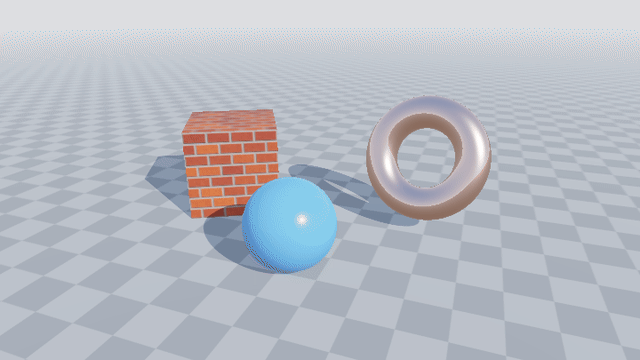
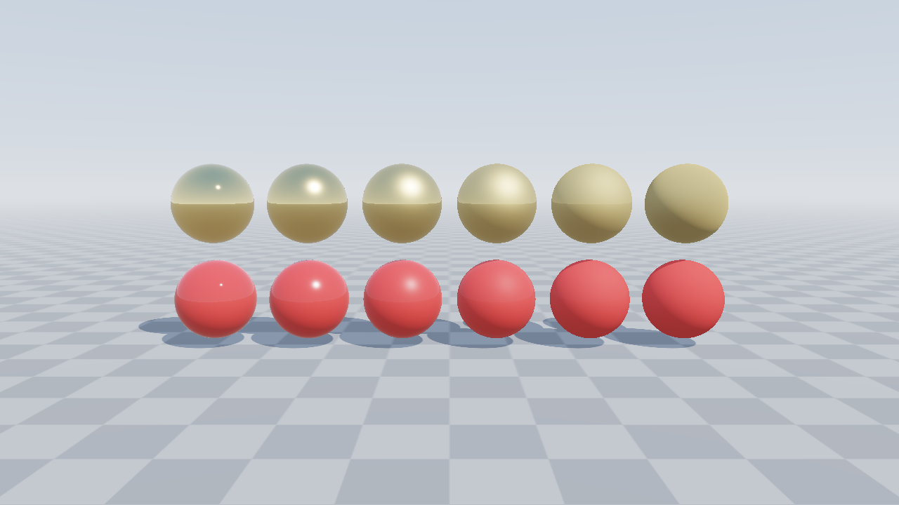
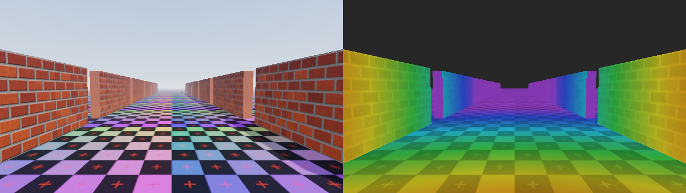
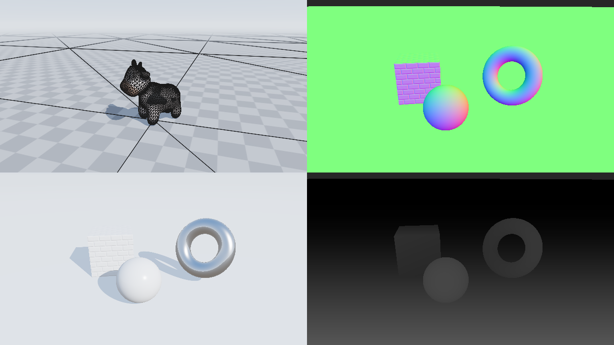
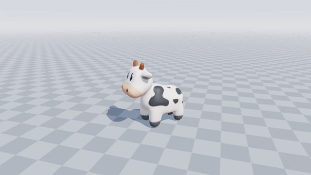

# tiny-software-renderer

[](https://github.com/feelgxxd/tiny-software-renderer/actions/workflows/ci.yml)


A multithreaded, tile-based **software rasterizer** written from scratch in C++17.
No OpenGL, Vulkan, or Direct3D: every pixel is produced on the CPU by code in this
repository, from vertex transformation and clipping to PBR shading and shadow mapping.
SDL2 is only used to put the finished image in a window.

**▶ [Live demo in your browser](https://feelgxxd.github.io/tiny-software-renderer/)**: the same C++ code
compiled to WebAssembly with pthreads. No WebGL is used for rendering.

<p align="center">
  
</p>

<p align="center">
  
  <br><em>Cook-Torrance GGX: metals (top) and dielectrics (bottom), roughness 0.06 → 1.0</em>
</p>

## Highlights

- **Tile-based parallel rasterization.** Triangles are binned into 64×64 tiles,
  and each tile is shaded by exactly one thread in submission order. There are no locks
  on the color or depth buffers, and frames are **bit-identical for any thread count**
  (enforced by a test).
- **Correct rasterization rules.** 24.8 fixed-point edge functions, the
  **top-left fill rule** (shared edges are never shaded twice or skipped, checked
  pixel-by-pixel on jittered meshes), and **homogeneous clipping** (Sutherland-Hodgman
  against the near/far planes plus a guard band).
- **SIMD quad shading.** Pixels are shaded in 2×2 quads, as on a GPU, using one
  4-wide vector type that maps to **SSE2, ARM NEON and WebAssembly SIMD128**, with a
  portable scalar fallback. Shading math, texture filtering, shadow-map PCF and the sky
  are vectorized, which is **2.2–2.4× faster per core** than the scalar reference shader.
  UV derivatives for mip selection come from neighboring lanes, the software
  equivalent of `dFdx`/`dFdy`.
- **Programmable pipeline.** C++ vertex and fragment "shaders" with up to 16
  perspective-correct varyings. A shader can provide a SIMD quad function, or only a
  scalar one that the pipeline runs per lane.
- **Runs in the browser.** The same code compiles to WebAssembly with pthreads and
  SIMD128 for the [live demo](https://feelgxxd.github.io/tiny-software-renderer/).
- **Textures.** Linear-space mip chains, trilinear filtering, sRGB decoding, and
  repeat wrapping.
- **Physically based shading.** Cook-Torrance BRDF (GGX / Smith / Schlick),
  metallic-roughness materials, tangent-space normal mapping, a split-sum ambient
  approximation from an analytic sky, ACES filmic tone mapping, and distance fog.
- **Shadow mapping.** Orthographic light frustum, normal-offset bias, and
  bilinear-weighted 3×3 PCF for soft edges.
- **Tooling.** Headless CLI renderer, interactive viewer, debug views (wireframe,
  normals, lighting, mip level, depth), a per-tile cost heatmap, and a thread-scaling
  benchmark.
- **Tested in CI** on Windows, Linux and macOS (x86-64 and ARM64): unit tests,
  rasterization-rule tests, a determinism test, a SIMD-vs-scalar parity test, and
  golden-image regression tests.

## Gallery

<p align="center">
  
  <br><em>Left: trilinear filtering keeps the far floor stable. Right: selected mip level per pixel (red = level 0).</em>
</p>

<p align="center">
  
  <br><em>Debug views: wireframe overlay (clipping-generated edges are hidden), world normals with normal mapping, lighting only, linear depth.</em>
</p>

<p align="center">
  
  <br><em>OBJ loading and texturing: <a href="https://www.cs.cmu.edu/~kmcrane/Projects/ModelRepository/">Spot</a> by Keenan Crane.</em>
</p>

## How it works

```mermaid
flowchart LR
    A[Mesh + Shader] --> B[Vertex shading<br/>parallel over vertices]
    B --> C[Primitive assembly<br/>outcode trivial accept/reject]
    C --> D[Homogeneous clipping<br/>near/far + guard band]
    D --> E[Triangle setup<br/>fixed point, culling, bbox]
    E --> F[Binning<br/>64x64 tiles, in order]
    F --> G[Tile rasterization<br/>one thread per tile, 2x2 quads]
    G --> H[Early depth test]
    H --> I[SIMD fragment shading<br/>PBR, shadows, textures]
    I --> J[Sky fill + resolve<br/>ACES + sRGB]
```



1. **Geometry** (`Renderer::draw`): every unique vertex is shaded once, in parallel
   chunks. Triangles are assembled in parallel chunks that are concatenated in
   submission order, so draw order is preserved.
2. **Clipping**: triangles that are fully inside the frustum skip clipping entirely.
   The others are clipped in clip space, where linear interpolation of varyings is
   still correct. Each polygon edge carries a flag recording whether it comes from the
   original mesh, so the wireframe overlay never shows edges that clipping created.
3. **Setup**: positions are snapped to 1/256 pixel. The signed area gives the facing
   for culling, and the winding is normalized so the inner loop only handles one
   orientation.
4. **Raster** (`Renderer::end`): tiles are distributed to workers through an atomic
   counter. Each worker walks the triangle in 2×2 quads with incremental integer edge
   functions and the top-left bias. It then computes perspective-correct barycentrics
   for the 4 lanes at once, runs an early depth test, and calls the shader's quad
   function. Lanes outside the triangle still get extrapolated attributes ("helper
   lanes") so derivatives are defined, but they are never written.
5. **Sky**: after the main pass, only pixels that no geometry covered are filled. The
   view ray is linear in screen x, so this also runs 4 pixels per iteration.

For a longer explanation with diagrams, see **[How it works](docs/how-it-works.md)**.

The source is organized in layers:

```
src/math      Vec2/3/4, Mat4 (column vectors, OpenGL conventions), F4/V3 SIMD types
src/core      ThreadPool, Renderer (clip/setup/bin/raster), Framebuffer, Texture, Shader API
src/geometry  Mesh, OBJ loader, procedural primitives, tangent generation
src/render    PBR + shadow shaders, ShadowMap, sky, scenes, procedural textures
apps/         sr_render (headless CLI), sr_viewer (SDL2 window), sr_web (WebAssembly)
web/          live demo page and build script
tests/        unit, raster-rule, determinism, SIMD parity and golden-image tests
```

## Performance

Measured at 1280×720 on an AMD Ryzen AI 7 350 laptop (8 cores / 16 threads, SSE2
build), median of 25 frames under sustained load. Each frame includes the shadow pass,
the sky and all shading (`sr_render --scene all --bench`):

| Scene | Triangles | Scalar, 1 thread | SIMD, 1 thread | SIMD, 16 threads | SIMD gain | Total |
|---|---:|---:|---:|---:|---:|---:|
| materials (12 PBR spheres) | 63,104 | 108.1 ms | 85.0 ms | **12.6 ms (79 FPS)** | 1.27× | 8.6× |
| shadows (normal-mapped, animated) | 14,348 | 203.5 ms | 91.8 ms | **9.0 ms (111 FPS)** | 2.22× | 22.5× |
| textures (trilinear corridor) | 4,752 | 176.6 ms | 75.6 ms | **6.7 ms (149 FPS)** | 2.34× | 26.4× |
| spot (OBJ + texture) | 9,056 | 169.6 ms | 77.2 ms | **7.4 ms (135 FPS)** | 2.20× | 22.9× |

- **SIMD gain is lowest on `materials`.** Its spheres are made of many small triangles,
  so many quads are only partly covered, and the helper lanes do work that is thrown
  away. GPUs pay the same "quad overdraw" cost on small triangles.
- **Thread scaling is 6.7–11.2× on 8 physical cores.** SMT helps because much of the
  time is spent waiting on texture and shadow-map memory reads.
- **Single-thread numbers are higher than short runs.** A laptop CPU cannot hold its
  boost clock under sustained single-core load.
- In the browser (WebAssembly SIMD128 with 16 workers, 960×540), the same scenes render
  in 5–14 ms.

The viewer's **H** key shows which tiles cost the most, and **X** switches between the
SIMD and scalar shading paths.

## Building

Requirements: CMake ≥ 3.20 and a C++17 compiler (MSVC 2022+, GCC 9+, Clang 10+).
SDL2 is used when it is installed. Otherwise CMake downloads and builds it
automatically.

```bash
cmake -S . -B build -DCMAKE_BUILD_TYPE=Release
cmake --build build --config Release --parallel
ctest --test-dir build -C Release --output-on-failure
```

Binaries are placed in `build/bin/` (`build/bin/Release/` with Visual Studio).
Pass `-DSR_BUILD_VIEWER=OFF` for a headless build with no SDL dependency.

**WebAssembly demo.** `web/build.sh` builds two variants: one with pthreads, which needs
a cross-origin-isolated page, and a single-threaded fallback. It then copies them next
to `web/index.html`. The easiest way to run it is the official Emscripten image:

```bash
docker run --rm -v "$PWD:/src" -w /src emscripten/emsdk:3.1.74 web/build.sh
# then serve build-web/dist with any static file server
```

GitHub Pages cannot send the COOP/COEP headers that `SharedArrayBuffer` requires, so
the page registers [coi-serviceworker](https://github.com/gzuidhof/coi-serviceworker),
which adds them. In browsers where that fails, the page falls back to the
single-threaded build.

## Usage

```bash
# Interactive viewer
sr_viewer --scene shadows

# Headless rendering
sr_render --scene materials --width 1920 --height 1080 --out renders/materials.png
sr_render --scene textures --view mips          # debug views: albedo normals lighting mips depth
sr_render --scene spot --wireframe
sr_render --scene shadows --frames 120 --fps 30 # image sequence
sr_render --scene all --bench                   # scalar vs. SIMD, 1 vs. all threads
sr_render --scene all --bench-threads           # 1, 2, 4, ... N threads
sr_render --scene shadows --no-simd             # scalar reference shading path
```

| Viewer key | Action |
|---|---|
| Mouse drag / wheel | Orbit / zoom |
| `1`–`4` | Switch scene (materials, shadows, textures, spot) |
| `V` | Cycle debug view |
| `F` | Wireframe overlay |
| `S` | Toggle shadows |
| `T` | Switch between 1 thread and all threads |
| `X` | Switch between SIMD and scalar shading |
| `H` | Per-tile cost heatmap |
| `[` / `]` | Render scale |
| `Space` / `P` / `R` | Pause animation / screenshot / reset camera |

## Testing

`sr_tests` has no external dependencies. It covers:

- **Math**: inverse, `lookAt`, projection depth mapping, normal matrix under non-uniform scale
- **Rasterization rules**: jittered triangle grids at odd resolutions must shade every
  interior pixel exactly once (no cracks, no double blending) with 1, 4 and 8 threads
- **Clipping**: a ground plane that extends behind the camera renders with no NaNs and
  the expected coverage
- **Culling**: counter-clockwise front faces
- **Determinism**: 1-thread and 8-thread renders are compared byte for byte
- **SIMD parity**: the vectorized quad shader must match the scalar reference shader
  (mean difference under 0.25/255), plus unit tests for the vector `floor`/`exp2`/masks
- **Thread pool**: every work item runs exactly once whatever the active thread count
- **Golden images**: the scenes are compared against `tests/golden/*.png`, with
  tolerances for floating-point differences between compilers
  (`sr_tests --update-golden` regenerates the references)

The suite passes with MSVC, GCC and Clang on the SSE2 backend, on ARM64 with the NEON
backend, and with the scalar fallback (`-DSR_SIMD_SCALAR=ON`).

## Roadmap

- [x] SIMD quad shading (SSE2, NEON, WebAssembly SIMD128)
- [x] WebAssembly build with a live demo
- [ ] Hierarchical-Z tile rejection
- [ ] MSAA and alpha blending with an order-preserving transparent pass
- [ ] Image-based lighting from HDR environment maps
- [ ] glTF 2.0 loading

## Credits

- [stb_image / stb_image_write](https://github.com/nothings/stb) by Sean Barrett (public domain)
- [SDL2](https://www.libsdl.org/) (zlib license), used only to present frames
- [coi-serviceworker](https://github.com/gzuidhof/coi-serviceworker) by Guido Zuidhof (MIT), for cross-origin isolation on static hosts
- [Spot](https://www.cs.cmu.edu/~kmcrane/Projects/ModelRepository/) by Keenan Crane (public domain)
- [IBM Plex Mono](https://github.com/IBM/plex) and [Chakra Petch](https://github.com/m4rc1e/Chakra-Petch) fonts for the demo page (SIL Open Font License, see `web/fonts/`)
- The environment BRDF approximation follows Brian Karis, *Physically Based Shading on Mobile* (2014)

## License

[MIT](LICENSE)
