# tiny-software-renderer

[](https://github.com/feelgxxd/tiny-software-renderer/actions/workflows/ci.yml)


A multithreaded, tile-based **software rasterizer** written from scratch in C++17.
No OpenGL, Vulkan, or Direct3D: every pixel is produced on the CPU by code in this
repository, from vertex transformation and clipping to PBR shading and shadow mapping.
SDL2 is only used to put the finished image in a window.

<p align="center">
  
</p>

<p align="center">
  
  <br><em>Cook-Torrance GGX: metals (top) and dielectrics (bottom), roughness 0.06 → 1.0</em>
</p>

## Highlights

- **Tile-based parallel rasterization.** Triangles are binned into 64×64 tiles,
  and each tile is shaded by exactly one thread in submission order. There are no locks
  on the color or depth buffers, and frames are **bit-identical for any thread count**
  (enforced by a test).
- **Correct rasterization rules.** 24.8 fixed-point edge functions, the
  **top-left fill rule** (shared edges are never shaded twice or skipped, checked
  pixel-by-pixel on jittered meshes), and **homogeneous clipping** (Sutherland-Hodgman
  against the near/far planes plus a guard band).
- **Programmable pipeline.** C++ vertex and fragment "shaders" with up to 16
  perspective-correct varyings, plus **screen-space UV derivatives** (the software
  equivalent of `dFdx`/`dFdy`) for hardware-style mip selection.
- **Textures.** Linear-space mip chains, trilinear filtering, sRGB decoding, and
  repeat wrapping.
- **Physically based shading.** Cook-Torrance BRDF (GGX / Smith / Schlick),
  metallic-roughness materials, tangent-space normal mapping, a split-sum ambient
  approximation from an analytic sky, ACES filmic tone mapping, and distance fog.
- **Shadow mapping.** Orthographic light frustum, normal-offset bias, and
  bilinear-weighted 3×3 PCF for soft edges.
- **Tooling.** Headless CLI renderer, interactive viewer, debug views (wireframe,
  normals, lighting, mip level, depth), a per-tile cost heatmap, and a thread-scaling
  benchmark.
- **Tested in CI** on Windows, Linux and macOS: unit tests, rasterization-rule tests,
  a determinism test, and golden-image regression tests.

## Gallery

<p align="center">
  
  <br><em>Left: trilinear filtering keeps the far floor stable. Right: selected mip level per pixel (red = level 0).</em>
</p>

<p align="center">
  
  <br><em>Debug views: wireframe overlay (clipping-generated edges are hidden), world normals with normal mapping, lighting only, linear depth.</em>
</p>

<p align="center">
  
  <br><em>OBJ loading and texturing: <a href="https://www.cs.cmu.edu/~kmcrane/Projects/ModelRepository/">Spot</a> by Keenan Crane.</em>
</p>

## How it works

```mermaid
flowchart LR
    A[Mesh + Shader] --> B[Vertex shading<br/>parallel over vertices]
    B --> C[Primitive assembly<br/>outcode trivial accept/reject]
    C --> D[Homogeneous clipping<br/>near/far + guard band]
    D --> E[Triangle setup<br/>fixed point, culling, bbox]
    E --> F[Binning<br/>64x64 tiles, in order]
    F --> G[Tile rasterization<br/>one thread per tile]
    G --> H[Early depth test]
    H --> I[Fragment shading<br/>PBR, shadows, textures]
    I --> J[Resolve<br/>ACES + sRGB]
```



1. **Geometry** (`Renderer::draw`): every unique vertex is shaded once, in parallel
   chunks. Triangles are assembled in parallel chunks that are concatenated in
   submission order, so draw order is preserved.
2. **Clipping**: triangles that are fully inside the frustum skip clipping entirely.
   The others are clipped in clip space, where linear interpolation of varyings is
   still correct. Each polygon edge carries a flag recording whether it comes from the
   original mesh, so the wireframe overlay never shows edges that clipping created.
3. **Setup**: positions are snapped to 1/256 pixel. The signed area gives the facing
   for culling, and the winding is normalized so the inner loop only handles one
   orientation.
4. **Raster** (`Renderer::end`): tiles are distributed to workers through an atomic
   counter. Each worker runs incremental integer edge functions, applies the top-left
   bias, computes perspective-correct barycentrics, runs an early depth test, and then
   calls the fragment shader.

The source is organized in layers:

```
src/math      Vec2/3/4, Mat4 (column vectors, OpenGL conventions)
src/core      ThreadPool, Renderer (clip/setup/bin/raster), Framebuffer, Texture, Shader API
src/geometry  Mesh, OBJ loader, procedural primitives, tangent generation
src/render    PBR + shadow shaders, ShadowMap, sky, scenes, procedural textures
apps/         sr_render (headless CLI), sr_viewer (SDL2 window)
tests/        unit, raster-rule, determinism and golden-image tests
```

## Performance

Measured at 1280×720 on an AMD Ryzen AI 7 350 (8 cores / 16 threads), Release build,
including the shadow pass, sky and all shading (`sr_render --scene all --bench`):

| Scene | Triangles | 1 thread | 16 threads | Speedup |
|---|---:|---:|---:|---:|
| materials (12 PBR spheres) | 63,104 | 121.8 ms | **17.5 ms (57 FPS)** | 6.9× |
| shadows (normal-mapped, animated) | 14,348 | 154.9 ms | **18.4 ms (54 FPS)** | 8.4× |
| textures (trilinear corridor) | 4,752 | 132.6 ms | **15.6 ms (64 FPS)** | 8.5× |
| spot (OBJ + texture) | 9,056 | 131.3 ms | **15.3 ms (65 FPS)** | 8.6× |

The speedup slightly exceeds the 8 physical cores. A likely cause is SMT hiding the
memory latency of texture and shadow-map fetches. The viewer's **H** key shows which
tiles cost the most.

## Building

Requirements: CMake ≥ 3.20 and a C++17 compiler (MSVC 2022+, GCC 9+, Clang 10+).
SDL2 is used when it is installed. Otherwise CMake downloads and builds it
automatically.

```bash
cmake -S . -B build -DCMAKE_BUILD_TYPE=Release
cmake --build build --config Release --parallel
ctest --test-dir build -C Release --output-on-failure
```

Binaries are placed in `build/bin/` (`build/bin/Release/` with Visual Studio).
Pass `-DSR_BUILD_VIEWER=OFF` for a headless build with no SDL dependency.

## Usage

```bash
# Interactive viewer
sr_viewer --scene shadows

# Headless rendering
sr_render --scene materials --width 1920 --height 1080 --out renders/materials.png
sr_render --scene textures --view mips          # debug views: albedo normals lighting mips depth
sr_render --scene spot --wireframe
sr_render --scene shadows --frames 120 --fps 30 # image sequence
sr_render --scene all --bench                   # thread-scaling table
```

| Viewer key | Action |
|---|---|
| Mouse drag / wheel | Orbit / zoom |
| `1`–`4` | Switch scene (materials, shadows, textures, spot) |
| `V` | Cycle debug view |
| `F` | Wireframe overlay |
| `S` | Toggle shadows |
| `T` | Switch between 1 thread and all threads |
| `H` | Per-tile cost heatmap |
| `[` / `]` | Render scale |
| `Space` / `P` / `R` | Pause animation / screenshot / reset camera |

## Testing

`sr_tests` has no external dependencies. It covers:

- **Math**: inverse, `lookAt`, projection depth mapping, normal matrix under non-uniform scale
- **Rasterization rules**: jittered triangle grids at odd resolutions must shade every
  interior pixel exactly once (no cracks, no double blending) with 1, 4 and 8 threads
- **Clipping**: a ground plane that extends behind the camera renders with no NaNs and
  the expected coverage
- **Culling**: counter-clockwise front faces
- **Determinism**: 1-thread and 8-thread renders are compared byte for byte
- **Golden images**: the scenes are compared against `tests/golden/*.png`, with
  tolerances for floating-point differences between compilers
  (`sr_tests --update-golden` regenerates the references)

## Roadmap

- [ ] SIMD fragment pipeline (2×2 quads in SSE/AVX2 and NEON)
- [ ] Hierarchical-Z tile rejection
- [ ] MSAA and alpha blending with an order-preserving transparent pass
- [ ] Image-based lighting from HDR environment maps
- [ ] glTF 2.0 loading

## Credits

- [stb_image / stb_image_write](https://github.com/nothings/stb) by Sean Barrett (public domain)
- [SDL2](https://www.libsdl.org/) (zlib license), used only to present frames
- [Spot](https://www.cs.cmu.edu/~kmcrane/Projects/ModelRepository/) by Keenan Crane (public domain)
- The environment BRDF approximation follows Brian Karis, *Physically Based Shading on Mobile* (2014)

## License

[MIT](LICENSE)
