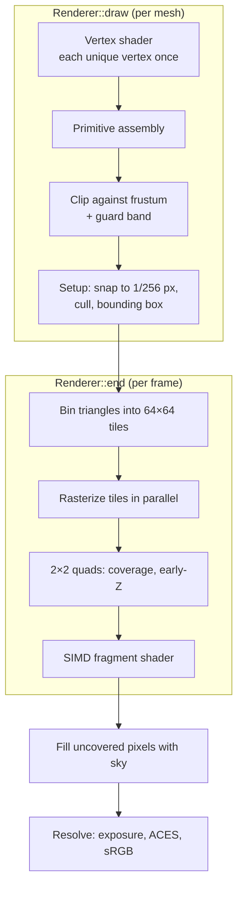

# How tiny-software-renderer works

This document follows one frame through the renderer. It covers the math behind each
stage, the design decisions and the bugs that shaped them. File references point into
`src/`. The live demo lets you toggle most of what is described here: threads, SIMD,
the tile heatmap and the debug views.

**Contents**

1. [The frame at a glance](#1-the-frame-at-a-glance)
2. [Spaces and transforms](#2-spaces-and-transforms)
3. [Clipping in homogeneous space](#3-clipping-in-homogeneous-space)
4. [Triangle setup in fixed point](#4-triangle-setup-in-fixed-point)
5. [Edge functions and the top-left rule](#5-edge-functions-and-the-top-left-rule)
6. [Perspective-correct interpolation](#6-perspective-correct-interpolation)
7. [Tiles and threads](#7-tiles-and-threads)
8. [2×2 quads and SIMD](#8-22-quads-and-simd)
9. [Textures and mip selection](#9-textures-and-mip-selection)
10. [Shading](#10-shading)
11. [Shadow maps](#11-shadow-maps)
12. [Running in the browser](#12-running-in-the-browser)
13. [How it is tested](#13-how-it-is-tested)
14. [Bugs worth remembering](#14-bugs-worth-remembering)

---

## 1. The frame at a glance



A scene frame (`SceneRenderer::render`) runs this pipeline twice:

1. A depth-only pass from the light into the shadow map.
2. The main pass into a linear HDR color buffer, followed by the sky fill.

The color buffer stays in linear `float` until the very end, where it is tone mapped
and encoded to 8-bit sRGB.

---

## 2. Spaces and transforms

The math library (`math/math.h`) follows OpenGL conventions:

- **Handedness:** right-handed world space, with the camera looking down −Z.
- **Vectors:** column vectors, so `v' = M * v` and transforms compose right to left.
- **Clip space:** after projection, a visible point satisfies −w ≤ x, y, z ≤ w.

```
object --model--> world --view--> eye --projection--> clip --(÷w)--> NDC --viewport--> window
```

The perspective matrix copies −z<sub>eye</sub> into w, so **w is the distance along
the view direction.** Two later stages depend on this: clipping (§3) and
perspective-correct interpolation (§6).

The viewport transform flips y, because window rows grow downward:

$$x_s = \left(\tfrac{x}{w}\cdot\tfrac12 + \tfrac12\right)W,\qquad y_s = \left(\tfrac12 - \tfrac{y}{w}\cdot\tfrac12\right)H,\qquad z_s = \tfrac{z}{w}\cdot\tfrac12 + \tfrac12$$

---

## 3. Clipping in homogeneous space

Dividing by w is only meaningful for w > 0. A triangle with one vertex behind the camera
does not project to a triangle: its edges wrap through infinity. Such triangles have to
be cut **before** the divide. The renderer does this in clip space, where everything is
still linear. That means varyings can be interpolated along a cut edge with the same
parameter *t* as the position.

`Renderer::clipAndEmit` runs Sutherland-Hodgman against seven planes. Each plane is a
signed distance; ≥ 0 means inside.

| Plane | Distance |
|---|---|
| w > ε | `w − 1e-5` |
| near / far | `z + w`, `w − z` |
| left / right / bottom / top | `4w ± x`, `4w ± y` |

**Guard band.** The x/y planes are four times wider than the screen. Triangles that are
only slightly off-screen are not cut at all, because the bounding-box scissor in the
rasterizer already ignores the off-screen pixels. Clipping at ±4w only exists to keep
fixed-point coordinates bounded (§4).

**Trivial accept and reject.** Each vertex gets a 7-bit outcode.
- If the AND of the three outcodes is non-zero, all vertices are outside the same plane
  and the triangle is dropped.
- If the OR is zero, the triangle is fully inside and skips clipping. This is the common
  case.

**Edge flags.** A clipped polygon is fan-triangulated, which creates diagonals that are
not edges of the mesh. Every polygon vertex therefore carries a flag that says whether
the edge leaving it lies on an original edge:

- A vertex created where the polygon **enters** the plane inherits the flag of the edge
  it was cut from.
- A vertex created where it **leaves** gets `false`, because the next edge runs along the
  clip plane.

The wireframe overlay draws only flagged edges, so clipping never shows up as stray lines.

---

## 4. Triangle setup in fixed point

Window positions are snapped to **24.8 fixed point** (1/256 pixel):

```cpp
tri.x[i] = lround(sx * 256);
```

Why not floats?
- **Watertightness.** Two triangles that share an edge must make exactly the same
  inside/outside decision for every pixel along it. In floating point, the edge
  function's rounding depends on the order of operations and on the triangle's other
  vertex. Integers give the same answer from both sides.
- **Range.** With the ±4w guard band and resolutions up to 8192, coordinates stay below
  about 2²³ in fixed point. Edge-function products therefore fit comfortably in `int64_t`.

Setup then:
- **Computes the signed area** with the edge function (§5). A counter-clockwise triangle
  in NDC becomes clockwise after the y-flip, so **negative area means front-facing.**
- **Culls** according to `DrawState::cull`. The main pass removes back faces; the shadow
  pass removes front faces (§11).
- **Normalizes the winding** by swapping two vertices (and their varyings), so the inner
  loop only handles positive area.
- **Computes a pixel bounding box** clamped to the render target.

---

## 5. Edge functions and the top-left rule

For a directed edge a→b and a sample point p:

$$E_{ab}(p) = (b_x - a_x)(p_y - a_y) - (b_y - a_y)(p_x - a_x)$$

E is twice the signed area of the triangle (a, b, p). For a positive-area triangle,
p is inside when all three edge functions are ≥ 0. Dividing them by the total area gives
the **barycentric coordinates**: the edge opposite vertex *i* gives vertex *i*'s weight.

E is linear in p. Stepping one pixel to the right adds −(b<sub>y</sub> − a<sub>y</sub>)·256,
and stepping one row down adds (b<sub>x</sub> − a<sub>x</sub>)·256. The rasterizer evaluates
E once per triangle per tile and then only adds integers.

**Ties.** A pixel center that lies exactly on a shared edge has E = 0 for both triangles.
"≥ 0" shades it twice, which breaks blending and wastes work. "> 0" shades it in neither
triangle and leaves a crack. The **top-left rule** (the same rule Direct3D and OpenGL use)
assigns a pixel on an edge only to the triangle for which that edge is a *top* edge or a
*left* edge. In y-down window space with positive area:

```cpp
bool isTopLeft(a, b) { int dx = b.x - a.x, dy = b.y - a.y; return dy < 0 || (dy == 0 && dx > 0); }
```

The rule is applied as a bias: an edge that is not top-left requires E ≥ 1 instead of
E ≥ 0. Because coordinates are integers, this is exact.

```
        ●            two triangles share the vertical edge x = 3
       ╱│╲
      ╱ │ ╲          pixel centers exactly on that edge:
     ╱ A│B ╲           - it is the RIGHT edge of A → A skips them
    ╱   │   ╲          - it is the LEFT edge of B  → B shades them
   ●────●────●
```

The test `raster: top-left fill rule shades shared edges exactly once` renders a grid of
triangles with jittered sub-pixel vertices at odd resolutions. It counts how many times
each pixel is shaded and requires exactly one.

---

## 6. Perspective-correct interpolation

Barycentrics computed in screen space are wrong for attributes. Perspective compresses
distant parts of a triangle, so a texture would swim and bend. The fix comes from one
fact: **attribute/w and 1/w are linear in screen space**, even though the attribute
itself is not.

With screen-space barycentrics λ<sub>i</sub>:

$$\frac{1}{w} = \sum_i \frac{\lambda_i}{w_i},\qquad
a = \frac{\sum_i \lambda_i\, a_i / w_i}{\sum_i \lambda_i / w_i}$$

The rasterizer folds this into **perspective-correct barycentrics**
b<sub>i</sub> = (λ<sub>i</sub>/w<sub>i</sub>) / Σ(λ<sub>j</sub>/w<sub>j</sub>). Every varying is
then a plain weighted sum `b0*v0 + b1*v1 + b2*v2`. That costs one division per pixel,
or one SIMD division per quad.

**Depth needs no correction.** z<sub>ndc</sub> = z/w is already a projective quantity, so
it *is* linear in screen space. The depth buffer interpolates it with the plain λ<sub>i</sub>.

The **textures** scene is the stress test for this stage: a 240 m floor with a UV grid
that runs to the horizon.

---

## 7. Tiles and threads

After all draws in a frame have been set up, `Renderer::end`:

1. **Bins** every triangle into each 64×64 tile its bounding box overlaps. Bins are filled
   in submission order.
2. **Distributes tiles** to workers through an atomic counter (`ThreadPool::parallelFor`).
   Expensive tiles do not stall cheap ones, so the load balances itself.
3. **Rasterizes each tile on a single thread**, processing that tile's triangles in order.

This has three consequences:

- **No locks.** No two threads ever touch the same pixel, so color and depth writes are
  plain stores.
- **Determinism.** Each pixel sees the same triangles in the same order regardless of
  the thread count. Frames are bit-identical for 1 and 8 threads, and a test checks this
  byte by byte.
- **Draw order without sorting.** The single-threaded painter's-order semantics are
  preserved, which is what a later transparency pass will need.

Geometry work also runs in parallel. Unique vertices are shaded in chunks. Triangles are
assembled and clipped in chunks whose outputs are concatenated in order. The viewer's
**tile heatmap** (key `H`) times every tile: normal-mapped, shadowed surfaces glow red,
while sky tiles are almost free.

**The thread pool never creates threads after startup.** Changing the thread count only
changes how many existing workers join each job. §12 explains why this matters in the
browser.

---

## 8. 2×2 quads and SIMD

Fragments are produced in 2×2 quads, as on a GPU:

```
lane 0 = (x, y)     lane 1 = (x+1, y)
lane 2 = (x, y+1)   lane 3 = (x+1, y+1)
```

- **Quads are aligned to even coordinates.** Tiles are 64-pixel aligned, so a quad never
  spans two tiles, and therefore never spans two threads.
- **Coverage, ownership and early depth tests are per lane.**
- **Helper lanes.** If any lane of a quad survives, all four lanes get interpolated
  attributes, including lanes outside the triangle. Their values are needed for
  derivatives, but they are never written. Their 1/w can extrapolate past zero near the
  horizon, so the sum is clamped before dividing. A NaN in a helper lane would otherwise
  poison the whole quad's mip level.

**Free derivatives.** The UV derivative is simply the difference between neighboring
lanes: `ddx = lane1 − lane0`, `ddy = lane2 − lane0` (a "coarse" derivative, one per quad).
The earlier scalar renderer had to evaluate two extra perspective-correct UVs per pixel
for the same information.

**One vector type, four backends.** `math/simd.h` defines `F4` (4 floats), `M4` (lane
mask) and `V3` (structure-of-arrays vec3) with operators, `min/max/sqrt/floor/select`
and an `exp2` that writes the integer part straight into the float exponent:

| Backend | Selected when | Notes |
|---|---|---|
| SSE2 | x86-64 (always available) | `floor` emulated: truncate, then fix negatives |
| NEON | AArch64 (Apple Silicon, ARM Linux) | native `vrndmq`, `vdivq`, `vsqrtq` |
| WASM SIMD128 | Emscripten with `-msimd128` | `pmin`/`pmax` to match SSE semantics |
| scalar | fallback / `SR_SIMD_SCALAR` | plain loops; used to test the others |

**What is vectorized:**
- interpolation of all varyings
- the whole PBR shader (§10)
- texture coordinates and filter weights, with one LOD per quad
- the light-space transform for shadows
- the sky fill

**What is not:** texture and shadow-map *reads*, which are gathers.

Shadow PCF still benefits: each row of the 4×4 filter footprint is one unaligned 4-float
load and one vector compare.

Results at 1280×720 (sustained load):

| Scene | Scalar | SIMD | Gain |
|---|---:|---:|---:|
| shadows | 203.5 ms | 91.8 ms | 2.22× |
| textures | 176.6 ms | 75.6 ms | 2.34× |
| materials | 108.1 ms | 85.0 ms | 1.27× |

`materials` is the outlier because its spheres are made of thousands of small triangles.
Many quads are only partly covered, so a large fraction of lanes are helpers whose
results are thrown away. GPUs pay the same **quad overdraw** cost on small triangles.

The scalar per-pixel shader is kept as a reference (`--no-simd`, key `X`). A test
requires the two paths to agree to within 0.25/255 on average.

---

## 9. Textures and mip selection

**Mip chain.** Textures are decoded to linear `float` RGBA at load time, because sRGB
texels must not be averaged in gamma space. A full mip chain is then built with a 2×2
box filter.

**Choosing a level.** The level comes from the footprint of one pixel in texel space:

$$\rho^2 = \max\left(\left\|\tfrac{\partial uv}{\partial x}\cdot S\right\|^2, \left\|\tfrac{\partial uv}{\partial y}\cdot S\right\|^2\right),\qquad \text{lod} = \tfrac12\log_2\rho^2$$

S is the texture size. **Trilinear filtering** blends bilinear samples from the two
nearest levels. The `mips` debug view colors each pixel by its level (red = 0); on the
corridor floor the levels form smooth bands toward the horizon.

**Wrapping** uses repeat. For power-of-two sizes it is a bit mask, which also handles
negative coordinates correctly in two's complement.

---

## 10. Shading

`PbrShader` implements the metallic-roughness model used by most real-time engines.

**Direct light**, Cook-Torrance:

$$f = k_d\frac{\text{albedo}}{\pi} + \frac{D\,G\,F}{4\,(n\cdot v)(n\cdot l)}$$

| Term | Model |
|---|---|
| D | GGX distribution, α = roughness² |
| G | Smith with Schlick-GGX, k = (roughness + 1)² / 8 |
| F | Schlick Fresnel, F₀ = lerp(0.04, albedo, metallic) |
| k_d | (1 − F)(1 − metallic): metals have no diffuse term |

**Ambient light** comes from an analytic sky gradient instead of an HDR map:
- *Diffuse:* the sky's irradiance.
- *Specular:* Karis' analytic fit of the split-sum environment BRDF, multiplied by the
  sky radiance in the reflection direction, blurred toward irradiance as roughness grows.
- *Horizon fade:* reflections that point into the surface are faded out.

**Normal mapping.**
- Tangents are generated per vertex from UV gradients and orthogonalized against the
  normal (Gram-Schmidt).
- The bitangent sign is stored in `tangent.w`.
- UVs here are top-down (v grows downward) while normal maps use the OpenGL convention
  (+Y up), so the bitangent is −∂P/∂v.

**Output.**
- Distance fog blends toward the horizon color, which hides the edge of the ground plane.
- The resolve applies exposure, the ACES filmic curve (Narkowicz fit) and the sRGB
  transfer function through a 4096-entry lookup table.

---

## 11. Shadow maps

**Fitting the light frustum.** An orthographic projection is fitted around a bounding
sphere (center *c*, radius *r*) of the shadow casters:

```
eye = c − lightDir · 2r,   near = 0.5r,   far = 3.5r,   extent = ±r
```

**Depth pass.** It renders **back faces only**. For closed meshes this halves the
triangle count. It also stores the far side of each caster, which moves self-shadowing
artifacts ("acne") to surfaces that face away from the light, where N·L ≤ 0 hides them.

**Lookup.**
1. **Normal-offset bias.** Push the surface point along its normal by
   `texel · (1 + 2·(1 − N·L))`, more at grazing angles, then project it into light space.
2. **Depth bias.** Subtract a small constant (0.0008) from the depth before comparing.
3. **Filter.** A **3×3 grid of bilinear PCF taps** is equivalent to a 4×4 texel footprint
   with tent weights `[1−f, 1, 1, f]` in each axis (total weight 9). It produces smooth
   penumbrae from 16 compares, where a 5×5 box filter would need 25 and look blockier.

---

## 12. Running in the browser

**One codebase.** The demo is the same C++ compiled with Emscripten. `apps/viewer_app.cpp`
contains everything the desktop viewer does. `apps/sr_web.cpp` only adds a few
`EMSCRIPTEN_KEEPALIVE` functions that the HTML controls call.

**Threads.** WebAssembly threads require `SharedArrayBuffer`, which browsers only enable
on **cross-origin-isolated** pages, meaning pages served with COOP/COEP headers. GitHub
Pages cannot set headers, so the page registers
[coi-serviceworker](https://github.com/gzuidhof/coi-serviceworker), which re-serves the
page with them. If isolation still fails, the page loads a second, single-threaded build.
Both builds use SIMD128.

**Design constraint: don't create threads after startup on the web.** A WebAssembly
pthread is a Web Worker.
- Emscripten pre-spawns a fixed pool (`PTHREAD_POOL_SIZE = min(cores, 16)`).
- A thread beyond that pool can only start once the main thread returns to the browser's
  event loop.
- So a main thread that blocks waiting for such a thread deadlocks.

The first version of the thread slider rebuilt the pool. Worse, it constructed the new
pool before destroying the old one, which briefly needed twice the workers. The pool now
spawns its workers once and only changes how many participate in each job. That is also
cheaper on the desktop.

**Lesson: headless browsers lie about animation.** While testing the demo through the
DevTools protocol, the new headless mode sometimes stopped delivering
`requestAnimationFrame` after a burst of load, even though the page stayed responsive.
The same sequence ran flawlessly in a visible window and in the old headless mode.
Timing measurements in a real window are the ones that count.

---

## 13. How it is tested

`tests/` uses a minimal, dependency-free harness. CI runs it on Windows, Linux and macOS.

| Test | What it catches |
|---|---|
| Fill rule (jittered grids, odd sizes, 1/4/8 threads) | cracks or double-shaded pixels along shared edges |
| Near-plane clipping (floor extending behind the camera) | NaNs, wrap-around triangles, missing coverage |
| Back-face culling | winding convention regressions |
| Determinism (1 vs 8 threads, byte compare) | races, order-dependent tile processing |
| SIMD parity (quad shader vs scalar shader) | divergence between the two shading paths |
| SIMD primitives (`floor`, `exp2`, masks) | backend-specific mistakes |
| Thread pool (every item exactly once, any active count) | lost or duplicated work items |
| Golden images | any visual change. Tolerances (mean < 0.5/255, < 0.2% of channels off by > 24) absorb compiler-level float differences |

Every backend has been run against the same suite: MSVC, GCC and Clang with SSE2, GCC on
ARM64 with NEON, and the scalar fallback.

---

## 14. Bugs worth remembering

- **The black screen.** The original prototype multiplied `projection * view` with a
  math library whose matrices were laid out for row vectors. The view transform was
  applied after the projection, so nothing landed in the clip volume. The rewrite fixed
  the convention once, in one place (`math/math.h`). Tests now check that `lookAt` puts
  the eye at the origin and that the projection maps near/far to −1/+1.
- **Clipping artifacts in the wireframe.** Fan triangulation of clipped polygons drew
  long diagonals across the screen. The fix is the edge flags described in §3.
- **NaN in helper lanes.** Extrapolated 1/w can reach zero or below. The fix is to clamp
  the sum, and to make the LOD function treat NaN as "magnify" (`!(ρ² > 1)`).
- **A wrong accuracy claim.** The first SIMD `exp2` used Taylor-like coefficients and was
  documented as accurate to 2·10⁻⁷. A unit test measured 2·10⁻⁵. It now uses the Cephes
  minimax polynomial on [−½, ½], and the test enforces 5·10⁻⁷.

---

### References

- Juan Pineda, *A Parallel Algorithm for Polygon Rasterization* (1988): edge functions
- Fabian Giesen, *A trip through the Graphics Pipeline* (2011): rasterization, top-left rule, quads
- Brian Karis, *Real Shading in Unreal Engine 4* (2013) and *Physically Based Shading on Mobile* (2014)
- Krzysztof Narkowicz, *ACES Filmic Tone Mapping Curve* (2016)
- Daniel Holbert, normal offset shadows (GDC 2011 poster)
